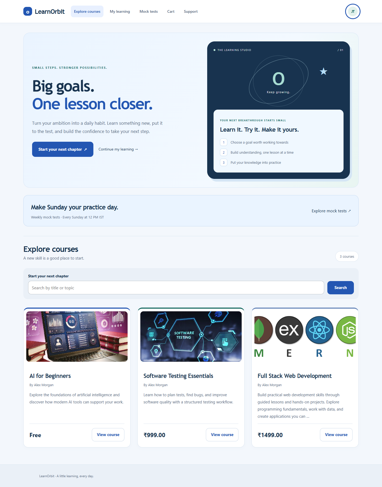
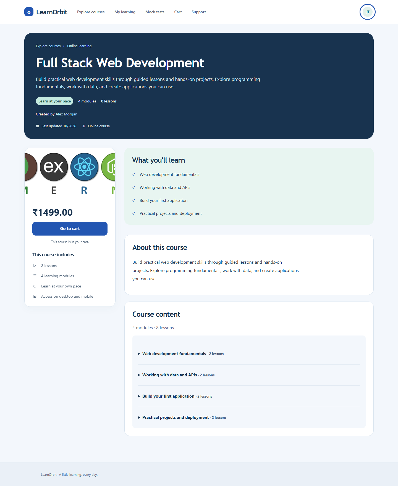
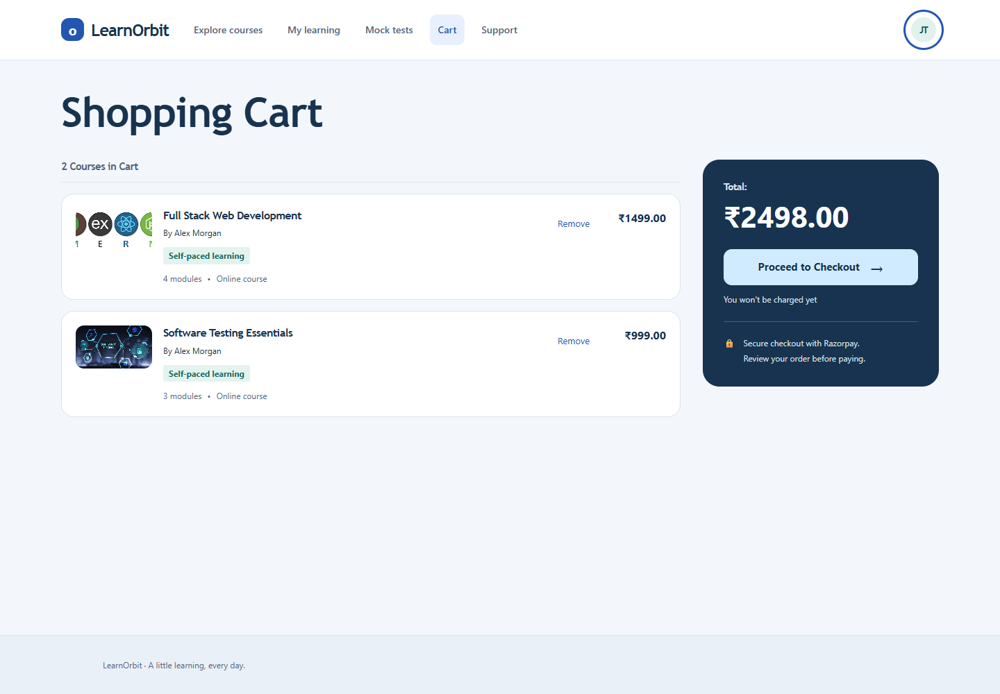
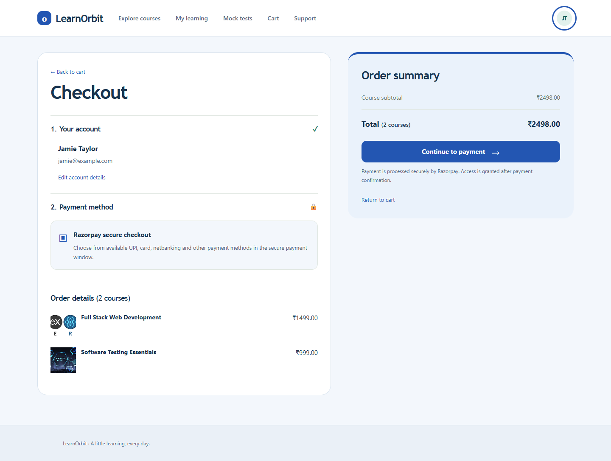
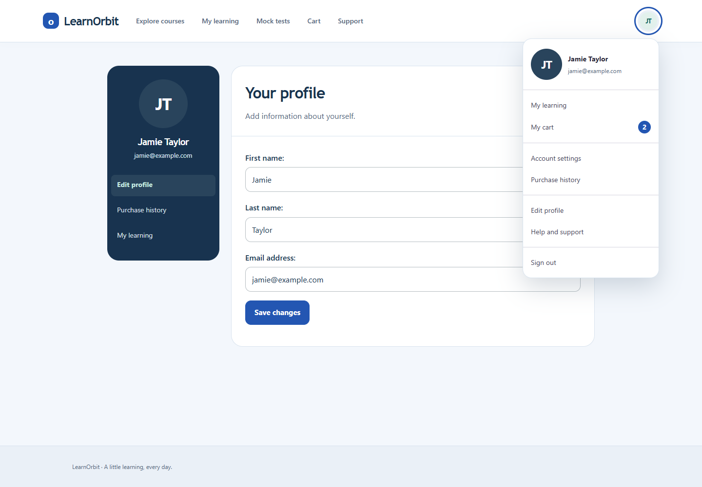
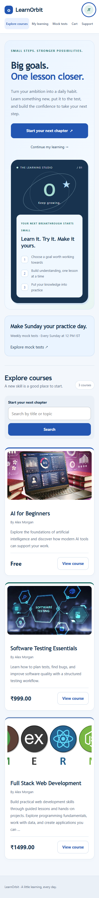
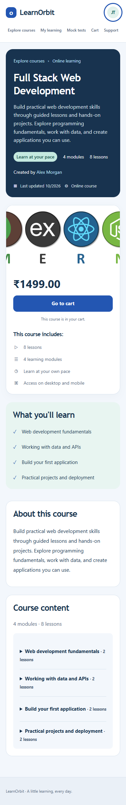
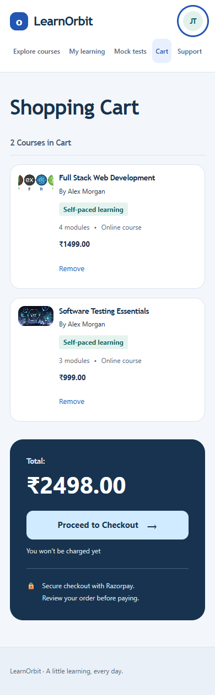
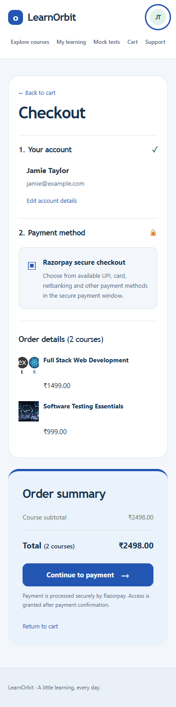
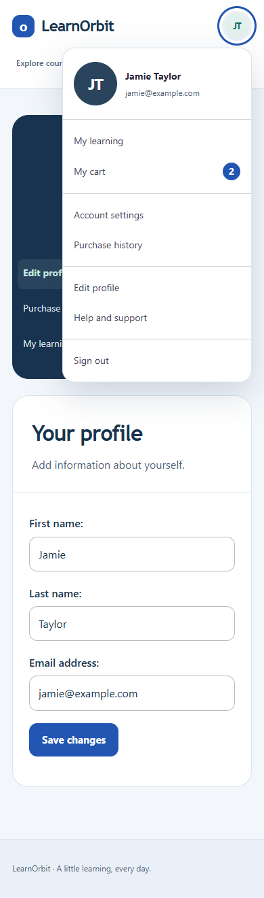

# LearnOrbit - E-Learning Management System

LearnOrbit is a Django learning platform where students can explore courses, manage their cart, pay through Razorpay, and access enrolled lessons. Instructors can organise course modules and lessons, while learners manage their profiles and purchase history through a responsive interface.

## Features

- Course discovery and search with detailed course pages.
- Student and instructor accounts, profile editing, and Google sign-in integration.
- Shopping cart, checkout, and free course enrolment.
- Razorpay order creation, payment verification, and signed webhooks.
- Enrolled course access and purchase history.
- Local demo payment mode for development.

## Screenshots

The screenshots below show the current minimal green interface on desktop and mobile. They use fictional demo accounts and sample courses.

### Explore courses


### Course details


### Shopping cart


### Checkout


### Profile and account menu


### Mobile previews

| Course catalogue | Course details |
| --- | --- |
|  |  |

| Shopping cart | Checkout | Profile |
| --- | --- | --- |
|  |  |  |

## Run locally

### Quizzes and scheduled live tests

Run `python manage.py migrate`, then `python manage.py seed_assessments` after creating the courses and lessons. The command adds one two-question introductory checkpoint after the first lesson and one two-question live foundation test after the final lesson of each recognised catalogue course. Existing assessments are skipped. These are starter question sets, editable in Django admin; expand them for full exam practice.

The first live tests are scheduled for **29 October 2026, 12:00–12:30 PM IST**, shared across courses. Students must be enrolled to access assessments. Open a lesson and choose **Quizzes & live tests**, or use the assessment links in the lesson curriculum. Links follow selected lessons; video completion is not tracked or required.

The four Kerala PSC and UPSC courses each have a dedicated **Scheduled Exam Tests** module. Their live tests appear in this module with the exam date, start time and duration visible in the curriculum. Running `seed_assessments` moves the existing foundation test into this module while preserving questions, schedules and attempts; it does not duplicate tests. Other courses retain live tests after their final lesson.

Each assessment allows one attempt per student. Questions and deadlines are frozen on start, answers are graded on the server, and submitted scores and explanations are saved. Late live-test starters have only the remaining shared window. The browser countdown attempts automatic submission; answers are saved only on submission. Attempts received after the server deadline expire with zero score. Live answer review opens after the shared closing time.

Administrators can add questions, place assessments after lessons, publish/unpublish tests, edit schedules, and review attempts through Django admin. The admin uses the project's UTC timezone: **12:00–12:30 PM IST is 06:30–07:00 UTC**. Student schedules explicitly display IST. A deleted attempt permits that student to retry; routine student retries are not enabled.

Verification: all 37 workflow tests pass, including scoring, enrolment, CSRF, attempt privacy, question snapshots, deadline enforcement and live answer-review timing. Desktop and 320px/390px layout checks and timer/radio interaction checks pass. Example previews: `docs/screenshots/assessments.png`, `quiz.png`, and `quiz-result.png`.

### Exam-preparation catalogue

Run `python manage.py seed_exam_videos` to add two credited public YouTube lessons and a preview to each exam course. It creates missing exam courses first and skips videos already present. Selected modules contain introductory videos; other modules remain outlines and practice materials are pending. Videos remain freely available on their creators' YouTube channels. Listed prices are project demo prices. Lesson pages include a direct YouTube link when embedded playback is unavailable. Playback depends on YouTube and the uploader's embedding settings.

Run `python manage.py seed_exam_courses` to add six curriculum previews covering general reasoning (INR 499), quantitative aptitude (INR 699), Kerala PSC foundations (INR 1,499) and practice (INR 999), UPSC general studies (INR 1,999), and UPSC CSAT (INR 999). Each includes four module outlines and an original cover. Running the command again skips existing titles. Existing courses are retained. The course-only command adds outlines; use the video command above for introductory lessons. Add remaining teaching content and practice materials through course administration before using them as full courses. They are independent study resources, not official exam offerings.

Built with Python, Django, SQLite, HTML, CSS, and JavaScript.

```powershell
py -m venv .venv
.\.venv\Scripts\python.exe -m pip install -r requirements.txt
Copy-Item .env.example .env
```

Set a unique `SECRET_KEY` in `.env`. Use `LEARNORBIT_DEBUG=True` for local development. This project-specific setting takes precedence over a generic host `DEBUG` variable. Add your Razorpay test keys for payment testing, or set `PAYMENT_DEMO=True` to try the local simulation without charging money.

```powershell
.\.venv\Scripts\python.exe manage.py migrate
.\.venv\Scripts\python.exe manage.py runserver
```

Open http://127.0.0.1:8000/. Create an administrator with `manage.py createsuperuser` to manage course records.

See [the setup and integration notes](README_REDESIGN.md) for Razorpay webhook configuration and deployment details. Keep `.env` and API secrets out of version control.

### Downloadable PDF study notes

Enrolled learners can use **Download PDF notes** on a lesson page or the enrolled course overview. The server generates a course-specific, two-page revision guide with concepts, a worked example, recall prompts and the current module roadmap. Existing catalogue courses include original introductory material; unrecognised future course titles receive a general study worksheet based on their modules. Notes are independent study companions, not complete syllabuses.

The `course-notes` route checks signed-in enrolment, returns a PDF attachment and disables response caching. Files are generated in memory rather than exposed through public media storage. Install the updated requirements before running the app. For PDF verification, `.screenshot-work/verify_notes.py` additionally uses PyMuPDF to render all course notes under `tmp/pdfs/`.

### Weekly Sunday mock tests

Run `python manage.py migrate`, then `python manage.py seed_sunday_mocks` after seeding the course assessments. The **Mock tests** navigation link opens course-style cards showing the next session and enrolment action. All 11 catalogue courses have a weekly series in **Scheduled Exam Tests**. Sessions run every Sunday, **12:00–12:30 PM IST**, starting **1 November 2026**.

The app creates the current or next occurrence when the mock hub or course assessment list is opened. Each occurrence has its own questions snapshot and attempt, so earlier results are retained and students get a fresh attempt each week. Existing one-off tests are retained. The starter question bank is reused; instructors can expand or rotate the weekly series questions in admin. No background scheduler is required. Re-running the setup command skips existing series. All 40 tests pass, including IST boundary handling, repeat generation and separate weekly attempts. Mock-card screenshots are in `docs/screenshots/mock-tests.png` and `mock-tests-mobile.png`.
